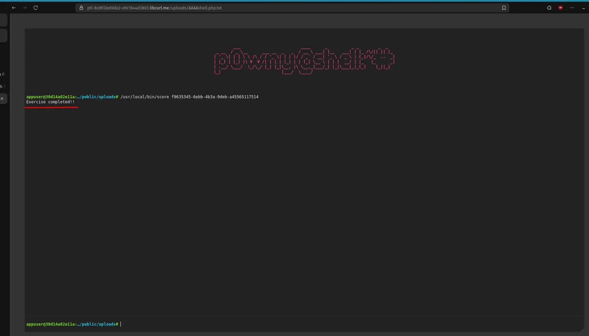

A one-byte accounting error between an uppercase character and its lowercase form is enough to turn a harmless file upload into remote code execution. This write-up walks through how PHP decides which file to run, where FrankenPHP's extension check goes wrong, and why the character `Ⱥ` is the key to the exploit.

## Background: How the Server Tells PHP What to Run

PHP doesn't handle HTTP requests on its own. A web server (Apache, Nginx, or FrankenPHP) receives the request first, works out which script should run, and passes the request details along to PHP. That hand-off follows the **CGI (Common Gateway Interface)** standard, where the server hands PHP a set of environment variables.

For a request to `https://host/uploads/script.php/some/extra/path?cmd=whoami`, the variables that matter most are:

| Variable | Purpose | Example |
| --- | --- | --- |
| `SCRIPT_FILENAME` | Absolute path of the PHP file to execute | `/app/public/uploads/script.php` |
| `SCRIPT_NAME` | URL path identifying the script | `/uploads/script.php` |
| `PATH_INFO` | Extra path after the script name | `/some/extra/path` |
| `QUERY_STRING` | The `?key=value` portion | `cmd=whoami` |
| `DOCUMENT_ROOT` | Root directory of the application | `/app/public` |

The critical one is `SCRIPT_FILENAME`. When PHP receives a request, it reads `SCRIPT_FILENAME` to decide **which file on disk to load and execute**, and it trusts the web server to have set that value correctly. PHP doesn't second-guess whether the target "should" be a PHP file. If `SCRIPT_FILENAME` points at `/app/public/uploads/evil.txt` and that file contains `<?php ... ?>`, PHP will happily execute it.

So the security of the whole arrangement rests on the server computing the script path correctly. That is exactly where this bug lives.

## The Flaw: A Case-Insensitive Extension Check

To support `.PHP`, `.Php`, `.pHp` and every other capitalization, FrankenPHP lowercases the path before looking for the `.php` extension. In spirit, the logic is:

```go
// Illustrative of the pattern, not verbatim FrankenPHP source.
lowered := strings.ToLower(path)
idx := strings.Index(lowered, ".php")
// ... then use idx to split the script path from PATH_INFO,
// slicing the ORIGINAL path at an index computed on the lowered one.
scriptName := path[:idx+len(".php")]
pathInfo := path[idx+len(".php"):]
```

For pure ASCII, this is fine: lowercasing an ASCII letter never changes its byte length (`P` → `p` is one byte either way), so an index found in the lowered string lines up perfectly with the original.

The bug is a side effect of being thorough. `strings.ToLower()` performs **full Unicode case folding**, not just ASCII. For some characters, the lowercase form needs *more bytes* in UTF-8 than the uppercase form. When that happens, an index measured on the lowered string no longer points at the same position in the original string.

## Why `Ⱥ` Is the Key

A handful of Unicode characters expand by one byte when lowercased. Two of them:

| Character | Codepoint | UTF-8 bytes | Lowercase | Codepoint | UTF-8 bytes | Change |
| --- | --- | --- | --- | --- | --- | --- |
| `Ⱥ` | U+023A | `C8 BA` (2) | `ⱥ` | U+2C65 | `E2 B1 A5` (3) | **+1 byte** |
| `Ⱦ` | U+023E | `C8 BE` (2) | `ⱦ` | U+2C66 | `E2 B1 A6` (3) | **+1 byte** |

Each `Ⱥ` in the path adds one byte of offset error. Line up four of them and the index drifts by four bytes, which is exactly enough to move the detected `.php` boundary off the real one.

Consider the path `/ⱭⱭⱭⱭshell.php.txt`. Here is the original request path, 22 bytes:

```text
Offset  Bytes       Char
0       2F          /
1-2     C8 BA       Ⱥ
3-4     C8 BA       Ⱥ
5-6     C8 BA       Ⱥ
7-8     C8 BA       Ⱥ
9       73          s
10      68          h
11      65          e
12      6C          l
13      6C          l
14      2E          .      <- ".php" begins here (byte 14)
15      70          p
16      68          h
17      70          p
18      2E          .
19      74          t
20      78          x
21      74          t
```

After `strings.ToLower()`, each `Ⱥ` (2 bytes) becomes `ⱥ` (3 bytes), pushing everything after the four characters 4 bytes to the right. The string is now 26 bytes:

```text
Offset  Bytes       Char
0       2F          /
1-3     E2 B1 A5    ⱥ
4-6     E2 B1 A5    ⱥ
7-9     E2 B1 A5    ⱥ
10-12   E2 B1 A5    ⱥ
13      73          s
14      68          h
15      65          e
16      6C          l
17      6C          l
18      2E          .      <- ".php" now begins at byte 18 (shifted +4)
19      70          p
20      68          h
21      70          p
22      2E          .
23      74          t
24      78          x
25      74          t
```

The code finds `.php` at byte 18 in the lowered string, then uses 18 to slice the **original** path, where `.php` actually starts at byte 14. The split lands in the wrong place, and the `.txt` file ends up being handed to PHP as a script to execute.

## Exploitation

The attack chain is short once an upload is allowed:

1. Upload a file whose name contains the expanding characters, for example `ⱭⱭⱭⱭshell.php.txt`, with a PHP payload inside it. A classic choice is a minimal web shell such as [p0wny-shell](https://github.com/flozz/p0wny-shell/blob/master/shell.php).
2. Request that file. FrankenPHP's offset miscalculation causes the server to set `SCRIPT_FILENAME` to the uploaded file and treat it as PHP.
3. PHP executes the payload, and the `.txt` file runs as code.

On the PentesterLab exercise, this lands a working web shell:



## The Fix

The root cause is comparing lengths and positions across two strings that no longer share a byte layout. The safe approaches all avoid that mismatch:

- **Don't change the byte length during the check.** Detect the extension in a way that operates on the original bytes, for example by lowercasing only ASCII letters so no multi-byte expansion can occur.
- **Compute and slice on the same string.** If the path is normalized, derive the split point from the normalized form and keep using that form, never mixing an index from one string with the bytes of another.
- **Reject ambiguous paths.** A request path for a script that contains non-ASCII characters in the extension region is suspicious on its own and can be refused.

More broadly, this is a reminder that `SCRIPT_FILENAME` is a security boundary. Anything that can steer it (path parsing, rewrites, uploads landing in a web-served directory) deserves the same scrutiny as an authentication check.

## Takeaways

- Case-insensitive matching on untrusted input is risky in any language with full Unicode case folding. An index found on a folded string is not safe to apply to the original.
- Path confusion keeps turning file uploads into code execution. Store uploads outside the web root, or serve them in a way that can never invoke an interpreter.
- When you review parsing code, watch for a length or index computed on one representation of a string and then used against another. That mismatch is where these bugs hide.
